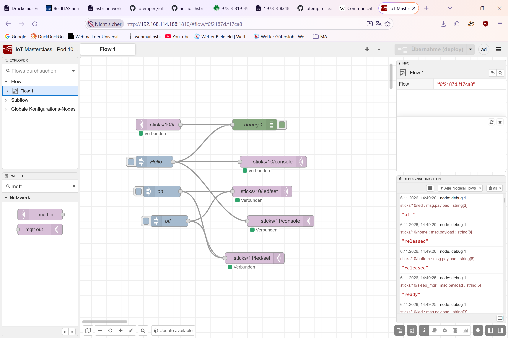
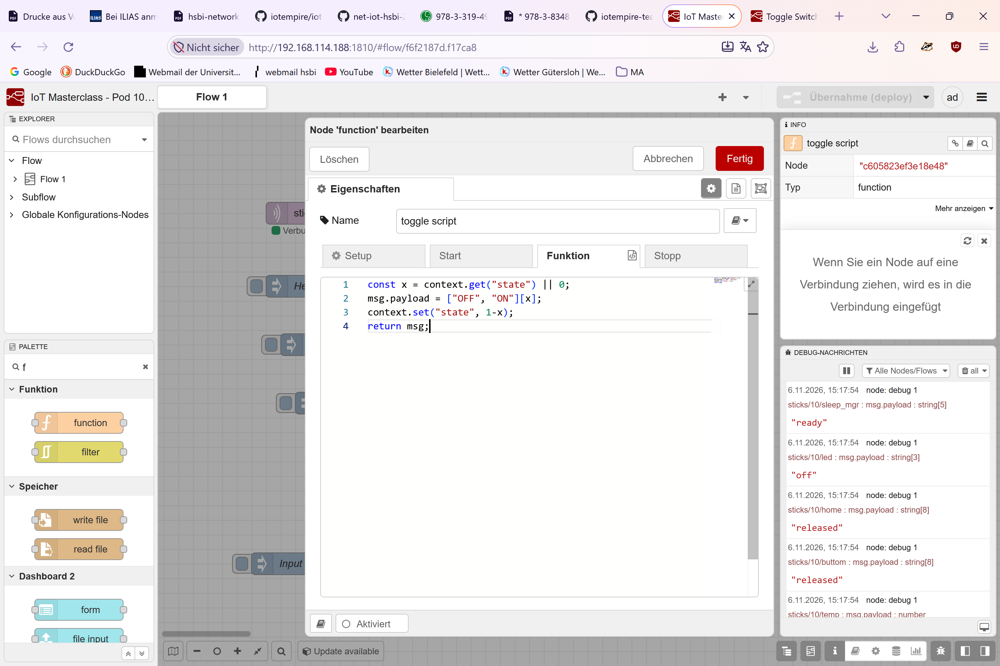
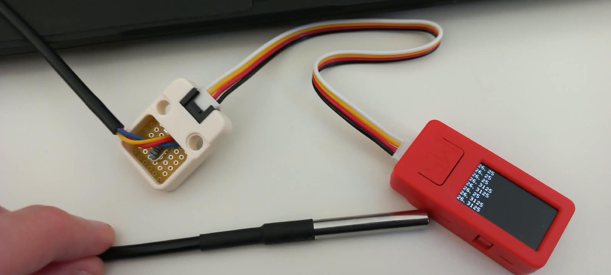

# Module 1

## Introduction
### Who I am

Programming experience? Python, C, C++  
I've built a radio with an Arduino before in a Microcontroller course at work - with an FM chip, no internet-radio.  
I've done traceroute in the PreStudy, I've only every pinged in games (in the noughties).  
I've never heard of WireShark, tcpdump, packet capture, Node-RED or this Nebula or Yggdrasil business before.  
I know of Git and GitHub, haven't really used it though.  
I want to connect a scale to my fridge, so my fridge won't open if I weigh too much.  
I expect to learn the basics of Networks and IoT.  

### My pod

[My podmate](https://github.com/Svenjjamin/net-iot-hsbi-2026-portfolio)  
We are Sven and Jan.

### Pre-study artefact

We talked about tracepath and MQTT-screenshots  
I previously didn't know different kinds of IP-addresses exist (IPv4 vs IPv6). Only actually looking at my ipconfig made me think about that.  
Why were the guiding questions mentioning concepts we hadn't learned anything about in the PreStudy tasks?

## Study log

### Warmup: 
Three devices are laptop, mobile phone and that router/repeater in the corner of the room. Can't tell from here.  
A sensor's data might take a roundtrip through the internet because it might not be the only source of data you want to look at and you might want to analyse it further, maybe even together with the other data.  
The layer describes which part of the network architecure is involved, a protocol describes how the communication in these layers is achieved.

### The ISO/OSI Reference Model vs. The TCP/IP Reality

The basics of the OSI model have been discussed in the PreStudy, the conflict the OSO or TCP/IP-models cause in regards to efficiency of data manipulation have been hinted at in the [RFC 3439 $3](https://www.rfc-editor.org/info/rfc3439/#s). And about RFC in general on [Wikipedia](https://en.wikipedia.org/wiki/Request_for_Comments).  

The encapsulation and decapsulation process is very nicely illustrated in this graphic that we got from Sebastian and Max.  
[Capsulation](./pictures/what-is-the-osi-model.svg) [Source](https://www.networkacademy.io/ccna/network-fundamentals/understanding-the-osi-model)  

### The Pub/Sub System
[MQTT basics](https://blog.berrybase.de/mqtt-basics-was-ist-mqtt-und-wie-richte-ich-einen-broker-ein/)  
The star hub or star topology refers to the fact that all data runs through the broker (via a topic the client published to) and is distributed via to the broker to the clients that want to recieve the data (via the topic they subscribe to).  

### Agreed learning (pod discussion)

The technologies that stuck around didn't necessarily stick around because they were the cleanest or best solutions.  
Header overhead is a big problem in IoT.  
The OSI-model is often being presented as THE big thing to know but doesn't seem to be as important.  
It is interesting how some protocols try to bypass the traditional layer boundaries but seem a bit sketchy at times.

### Shared Artifact
| OSI 7-Layer Model | TCP/IP 4-Layer Model | Protocol Data Unit (PDU) | Common Protocols |
|---|---|---|---|
| 7. Application 6. Presentation 5. Session | 1. Application Layer | Data / Message | HTTP, HTTPS, DNS, DHCP, FTP, SMTP, SSH |
| 4. Transport | 2. Transport Layer | Segment (TCP) / Datagram (UDP) | TCP (Reliable), UDP (Fast, Connectionless) |
| 3. Network | 3. Internet Layer | Packet | IPv4, IPv6 |
| 2. Data Link 1. Physical | 4. Network Access (Link) Layer | Frame (L2) / Bits (L1) | Ethernet (ARP), Wi-Fi |  

We really liked the overview this table gives over how OSI relates to TCP, Sebastian originally showed it to us.  
[Link](https://github.com/SebasAbt/IOT_Baseline/tree/main/Module01#osi-layer)

## Learning Goals

### LG1

Explain how this class works — learning goals as the contract, negotiable tasks, evidence in a portfolio — and start your own portfolio with a note on what you already know, what you expect, and who your pod is.  

**Evidence:** [Introduction](#Introduction)

### LG2

Explain publish/subscribe with an MQTT broker: the star topology, hierarchical topics, wildcards, and why decoupling producers from consumers is what makes an IoT system maintainable.  

**Evidence:**  There's multiple things we've done that refer to these ideas: The first one is the debug-node: We were listening to all incoming signals from our stick, regardless of where they originated. The second one is that we could easily publish our message not just to our own M5-stick but to our neighbors as well. In a connected system this would've meant additional physical connections that also need physical connectors, in our case we just needed to publish to another topic as well.  

### LG3

Build Node-RED flows that subscribe and publish, turn a physical button into a remote actuator action, and render live telemetry as a gauge, a chart, and a wildcard aggregation.  

**Evidence:** [Task 3](#task3) [Task 4](#task4) [Task 5](#task5) [Task 7](#task7) and [the flow we exported at one point](./flows.json)  

### LG4

Wire a digital 1-wire sensor, read its value over MQTT, and explain the declarative OTA loop (one line in setup.cpp → a fleet-wide deployment) and what it changes for a real fleet.  

**Evidence:** [Task 6](#task-6)

### LG5

Critically analyze the ISO/OSI 7-layer model against real TCP/IP in IoT systems (referencing RFC 3439 and RFC 1958), and quantify header overhead from a capture taken at the edge — the router, an ESP32 tap, or a provided dump — stating every assumption.  

**Evidence:** Well, that task didn't really happen. But Sebastian and Max found a neat little artefact about this [here](https://learningnetwork.cisco.com/s/question/0D53i00000Kt5N1CAJ/overhead-and-payload-confusion). We've established, even in the PreStudy, that the OSI model doesn't factor in that there are cross-layer considerations to be had at all and in our [Study Log](#study-log) we referred to RFC 3439 already. A key point is that an overly elaborate layering system leads to increased complexity where instead simplicity is warrented.

### LG6

Craft a system story that is concrete enough to pitch, spanning the computing continuum with named stakeholders, devices, and interfaces — and name the weakest link in it.  

**Evidence:** See [Tasks described by Sven](https://github.com/Svenjjamin/net-iot-hsbi-2026-portfolio/blob/main/Module01/README.md) 

## Task 1: Study in your pod

**Proves:** [LG1](#lg1)  

Answered in [Study Log](#study-log)  

## Task 2: Explain & share with another pod

**Proves:** [LG2](#lg2)

Answered in [Study Log](#study-log)

## Task 3: First contact - hello, Node-RED

  
This screenshot only happened later, so there's other stuff already happening as well. The broker is Mosquitto and in this instance the publisher is our inject-button in Node-RED and the subscriber the debugger in Node-RED.  
In the sidebar of this screenshot we see the M5Stick as the publisher instead.

**Proves:** [LG3](#lg3)

## Task 4: Your stick answers - button, LED, screen

Looks like we forgot to take a screenshot of this. We got busy sending messages to our neighbors, turning their LEDs on and off and connecting our LEDs to their LEDs to they would stop trying mess with ours.  
The message clearly traveled from the sick to the broker and back to the stick again, just publishing on one topic and then receiving on another.

**Proves:** [LG3](#lg3)

## Task 5: The domino chain - the room becomes a network

I think the consensus in the room was that we wouldn't do the domino chain. What we've done instead, was fail and finally succeed to implement a toggle function, so we could turn an LED on and off with the same exact input.  

 

**Proves:** [LG3](#lg3)

## Task 6: A real sensor and an OTA deploy

We decided we actually wanted our stick to show us the temperature:  
  

This actually took us surprisingly long since we had a typo in our topic and kept wondering why it showed up on in the console but not on screen. Reminded us of the nature of the wildcard again. 

**Proves:** [LG3](#lg4)

For the rest of the tasks see the [Tasks described by Sven](https://github.com/Svenjjamin/net-iot-hsbi-2026-portfolio/blob/main/Module01/README.md) 
 
## Reflection 1

[Reflection 1](../Reflections/ref01.md)
