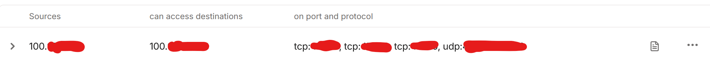

# Module 2

## Study log

We need to connect via DHCP apparently.  
Welp, that wasn't the problem actually, it was the change in IP, we were just confused because we couldn't see the connection.  
When trying to verify the wwan interface in round 3, we first didn't read the command correctly and wanted to input the colon as well, so tried to input "(CODE)"uci show firewall.@zone\[1\]: name='wan'" as a single input, that didn't work.  
When trying to connect to eduroam we couldn't find the IP address but we had additional network client visible and it only worked after we removed all redundant clients.  
After installing the USB-drive we had to reauthentificate not only in the shell but also in the browser.  
When I tried to connect to our router which we had expertly set up, I couldn't connect to the internet since we hadn't setup the LAN connection on radio0, so it never transferred the proper IP.  
Connecting to the WAN in the task about port forwarding was unsuccessful and we couldn't identify the cause.

## Learning Goals

### LG1

Configure IPv4 addressing, CIDR subnetting, default gateways, and routing tables.  

**Evidence:** [Task 1](#task-1) [Task 4](#task-4) [Task 6](#task-6)

### LG2

Inspect and diagnose the core IP plumbing services: ARP, DHCP (DORA), DNS, and NAT.  

**Evidence:** [Task 5](#task-5) [Task 7](#task-7)

### LG3

Flash, configure, administer, and secure an OpenWrt edge router via SSH and the LuCI web interface — from factory firmware to a working pod LAN with a WAN uplink (eduroam, phone tether, or the class Wi-Fi).  

**Evidence:** [Task 1](#task-1) [Task 2](#task-2) [Task 3](#task-3) [Task 4](#task-4) [Task 8](#task-8)

### LG4

Capture traffic at the choke point with tcpdump on the router, and read the dump with Wireshark, tshark, or as text — without needing a second network adapter.  

**Evidence:** [Task 5](#task-5)

## Tasks

This is not ideal since the guide we worked with in class used steps that did not align with the rounds in the module.  

### Task 1 — Flash OpenWrt - from factory to your router

- Model: TR1200  
- OpenWrt version: 25.12.6 (r33311-981c978eff)  
- The flash happens over ethernet because we want a stable connection.  

**Proves:** [LG1](#lg1)[LG3](#lg3)

### Task 2 — Extroot - give the router room

Extroot moved our overlay over to the stick. Only our new overlay, there is still a default overlay on the router.  

**Proves:** [LG3](#lg3)

### Task 3 — Uplink - consume eduroam on 5Ghz, or tether

We connected to eduroam, we now have someones credentials on the router (which is not a great feeling, since they apparently are saved in plaintext?).  

**Proves:** [LG3](#lg3)

### Task 4 — Build the pod LAN and the local broker

  

**Proves:** [LG1](#lg1) [LG3](#lg3)

### Task 5 — Read the choke point - APR, DHCP, DNS, MQTT

See Sven: [Task 5 by Sven](https://github.com/Svenjjamin/net-iot-hsbi-2026-portfolio/blob/main/Module02/ReadME.md)

**Proves:** [LG2](#lg2) [LG4](#lg4)

### Task 6 — Tighten the subnet and pin a client

| CIDR | Subnet mask | Block size | Network address | Broadcast address | Usable host range |
|---|---|---:|---|---|---|
| /24 | 255.255.255.0 | 256 | 192.168.14.0 | 192.168.14.255 | 192.168.14.1 – 192.168.14.254 |
| /26 | 255.255.255.192 | 64 | 192.168.14.0 | 192.168.14.63 | 192.168.14.1 – 192.168.14.62 |
| /28 | 255.255.255.240 | 16 | 192.168.14.0 | 192.168.14.15 | 192.168.14.1 – 192.168.14.14 |

How it's calculated:  
**/24:** 32 − 24 = 8 host bits. 256 − 0 = 256 addresses. 2⁸ − 2 = 254 usable hosts.  

Rest analogous

The rest of the task is provided, again, by Sven: [Task 6 by Sven](https://github.com/Svenjjamin/net-iot-hsbi-2026-portfolio/blob/main/Module02/ReadME.md)  
(He's got all the screenshots since he's the one with the admin access, you know)

**Proves:** [LG1](#lg1)

### Task 7 — One door - port forwarding and NAT

Somewhat related to this task: I had to setup a mesh-vpn from my laptop to my desktop pc, since my laptop was too weak for a software we are using in a different course and I wanted to access my desktop pc in class instead. And I used port forwarding to make sure I can only access the specific ports I need for my desktop-streaming software to access only that software and can only access it with my laptop's specific IP address. I also made some specific exceptions in my firewall for this exact use case. But that's just me doing extracurricular activities, not this task specifically.  
  

This task however, we couldn't complete since we weren't in class and unable to get an IP-address for our WAN on Cudy. We believe that our personal experience with port forwarding is enough to substitute our learnings from this task.  
Sven has provided a screenshot of us being unable to confirm an IP-address for the WAN:  
  
  

**Proves:** [LG2](#lg2)

### Task 8 — Handoff - take the router home

[Task 8 by Sven](https://github.com/Svenjjamin/net-iot-hsbi-2026-portfolio/blob/main/Module02/ReadME.md)

**Proves:** [LG3](#lg3) 

### Task 9 — Why OpenWrt? - the router you can own

I see the point of digital sovereignty, this is a valid point of concern. But I'm going to be real here: At this point I do not care enough to actually invest my valuable time into getting open source solutions to run, unless I feel genuinely threatened. And I don't.

**Proves:** Nothing

## Reflection 2

[Reflection 2](../Reflections/ref02.md)

If the module is longer than 1 week, you might have several reflections within it. If not, delete this and the following.

## Reflection 3
[Reflection 3](../Reflections/ref03.md)
