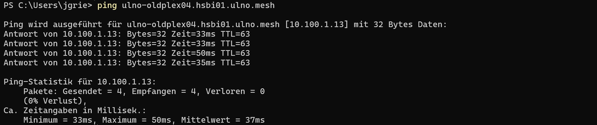
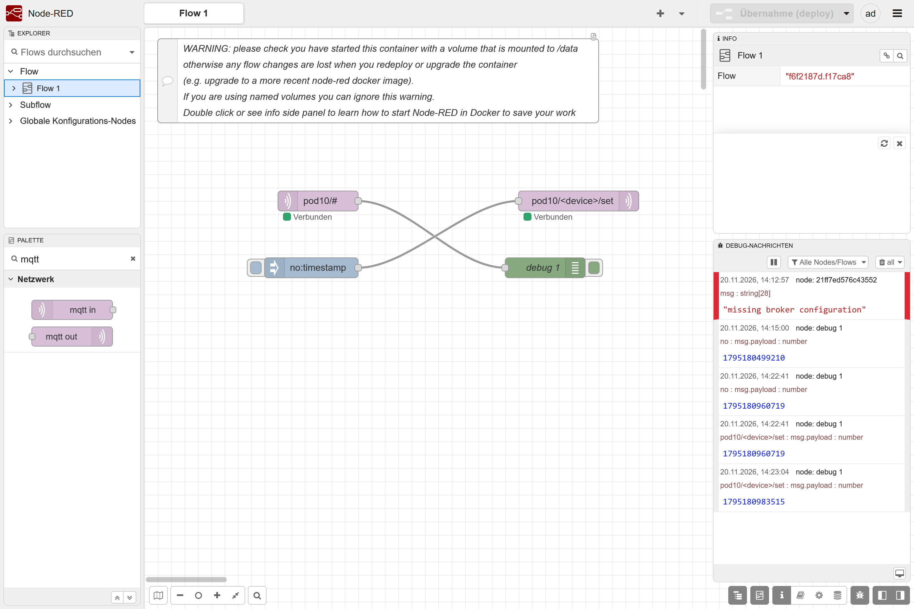
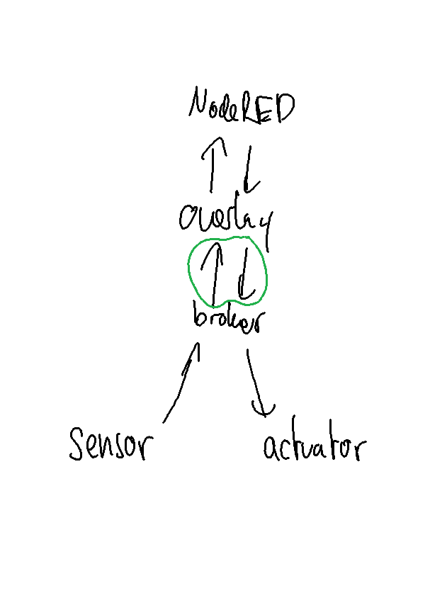
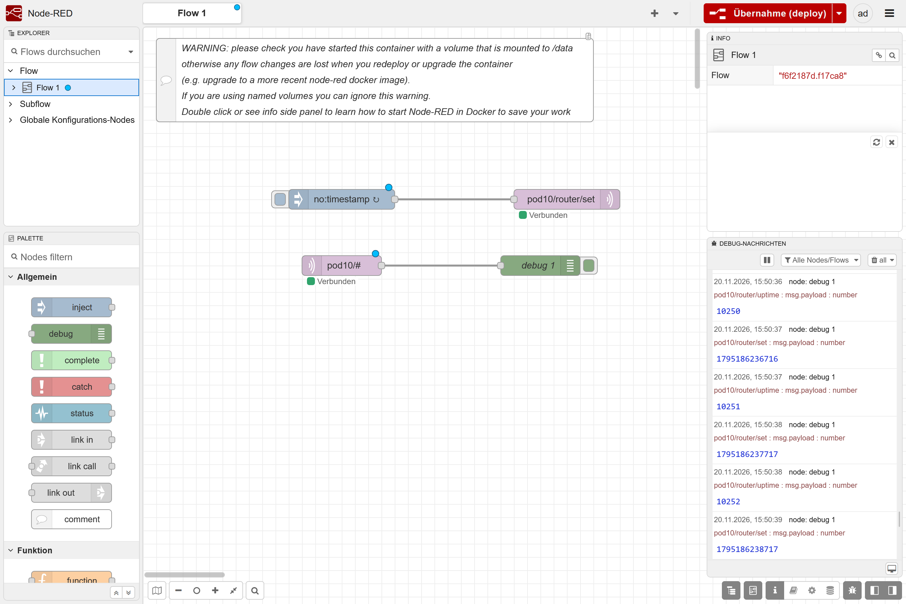

# Module 3

## Learning Goals

### LG1

Explain what an overlay network is and when it beats a port forward: changing WAN addresses, campus firewalls, CGNAT/DS-Lite, hole punching. (The NAT variants are optional depth; know the shape of the problem.)

**Evidence:** [Task 4](#task-4) [Task 5](#task-5)

### LG2

Deploy a Nebula node from a bundle on the router, and explain what the CA, the certificate, the key, and the config each do.

**Evidence:** [Task 1](#task-1) 

### LG3

Draw a network architecture involving an overlay network and explain the network and the roles in the mesh (nodes, certificate, peer, lighthouse).

**Evidence:** [Task 4](#task-4) 

### LG4

Make the router the pod's gateway into the overlay, reach your Node-RED instance on the Optiplex cluster through the overlay, and move one MQTT message each way.

**Evidence:** [Task 2](#task-2) 

## Tasks

### Task 1 — Connect your router to the overlay

Some step-by-step-screenshots from Sven:  
[Sven's module 3](https://github.com/Svenjjamin/net-iot-hsbi-2026-portfolio/blob/main/Module03/ReadME.md)

**Proves:** [LG2](#lg2)

### Task 2 — Reach Node-RED and move one message

  
  

**Proves:** [LG4](#lg4)

### Task 4 — Draw the networks and name the layers

[Sven has documented this](https://github.com/Svenjjamin/net-iot-hsbi-2026-portfolio/blob/main/Module03/ReadME.md)

**Proves:** [LG1](#lg1)[LG3](#lg3)

### Task 5 — Measure it

[Sven has documented this](https://github.com/Svenjjamin/net-iot-hsbi-2026-portfolio/blob/main/Module03/ReadME.md)

**Proves:** [LG1](#lg1)

### Task 6 — The router as a node

  
  

**Proves:** [LG4](#lg4)

## Reflection 3

[Reflection 3](../Reflections/ref03.md)